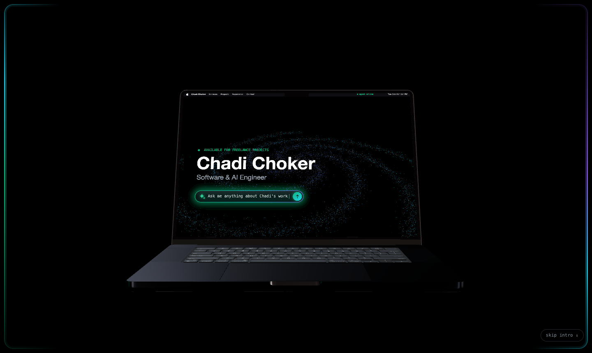
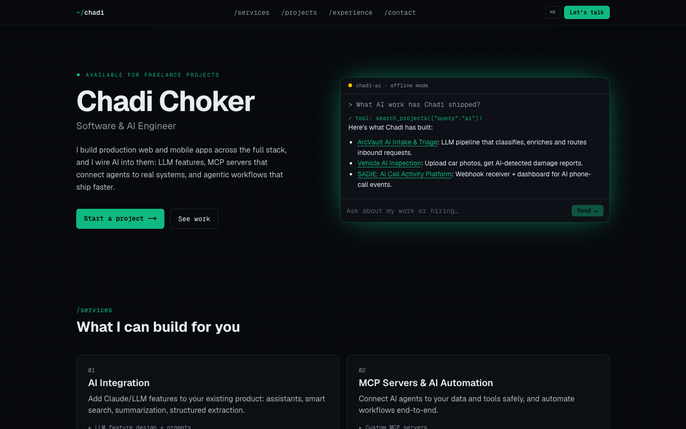

# Agent Console Portfolio





Portfolio of **Chadi Choker**, Software & AI Engineer.

It opens with a scroll-driven cinematic. A closed Space Black MacBook Pro opens, the display wakes to a macOS-style menu bar, and the camera dives into the screen, where the same latent-space galaxy becomes the site's living background.

The hero is a live Claude agent, **"Chadi's AI"**, that answers visitors' questions about my work. It calls tools over my real project, experience and service data, and visitors watch those tool calls happen. If no API key is configured, it falls back to a scripted offline mode, so the console never breaks.

**Lighthouse:** 100 across all categories on desktop. On mobile it's ~90 for Performance and 100 for the rest. The 3D loads in idle slices after first paint.

## Stack

Next.js 16 (App Router, Cache Components) · React 19 · TypeScript · Tailwind CSS v4 · three.js · Vercel AI SDK v7 · Claude Haiku 5.5 · cmdk · Vitest

## Architecture

| Path | Role |
|---|---|
| `src/content/*` | Single source of truth: projects, experience, services, skills |
| `src/agent/tools.ts` | Pure query functions over content. Used by the AI tools, the offline engine and the pages. |
| `src/app/api/chat/route.ts` | Streaming agent: 5 read-only tools, `stopWhen: stepCountIs(4)`, `maxOutputTokens: 600` |
| `src/lib/chat-guard.ts` | 12 messages and 500 characters per conversation, enforced on client and server |
| `src/agent/scripted.ts` | Offline keyword engine, used when the API is unavailable |
| `src/components/console/*` | `ConsoleLoader` renders a lightweight shell, and the live `AgentConsole` (AI SDK, markdown) loads on first interaction |
| `src/three/choreography.ts` | Pure scroll → pose mapping for the intro (lid, turn, power, dive, hand-off). Unit-tested. |
| `src/three/world.ts` | One fixed WebGL canvas. Renders the rigged MacBook with the galaxy on its display (render target), then the same galaxy as the background. |
| `src/three/galaxy.ts` | GPU-animated spiral of points. `pulse()` sends a shockwave on every agent tool call. |
| `src/components/intro/Intro.tsx` | Scroll runway, boot log, skip control. Plays on every visit with a one-tap skip. It's skipped under reduced motion, data saver and no WebGL, and collapses if the 3D fails to load. |

## Run locally

```bash
npm install
cp .env.example .env.local   # ANTHROPIC_API_KEY is optional; without it the console runs offline
npm run dev
npm test
```

## Deploy (Vercel)

1. Import this repo in Vercel.
2. Set the environment variables:
   - `ANTHROPIC_API_KEY`: server-only
   - `NEXT_PUBLIC_SITE_URL`: your domain, used for the sitemap, OG images and canonical URLs
3. In the Anthropic Console, set a **monthly spend limit** on the key.

Netlify and Cloudflare also work. The site uses standard Next.js route handlers and no Vercel-only APIs.

## Credits

3D model: ["MacBook Pro M3 16-inch 2024"](https://sketchfab.com/3d-models/macbook-pro-m3-16-inch-2024-8e34fc2b303144f78490007d91ff57c4) by jackbaeten, licensed [CC BY 4.0](https://creativecommons.org/licenses/by/4.0/). Rigged and recoloured by William Laverty ([rigged-macbook-3d](https://github.com/william-laverty/rigged-macbook-3d), MIT).

This project is not affiliated with Apple Inc. MacBook is a trademark of Apple Inc.
